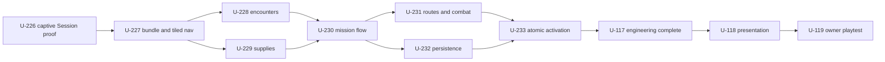

# U-117 — Integrate redesigned Mission 1 combat, supplies and objectives

Epic: Map implementation. Pillar: P6. Engineering aggregate; claim its leaves.
Human verdict: none for engineering closure; whole-mission owner quality remains
U-119 after U-118 and is not a prerequisite that would make that sequence circular.
Status, dependencies and work live in [BACKLOG.md](../../BACKLOG.md).
Source: U-107 design authorization, 2026-10-04; owner requested this split, 2026-10-17.
Canonical requirements: [Qalat construction specification](../design/maps/qalat-road.md).

## Scope and authorization

Deliver the approved replacement's combat, supplies, objectives and compatible
production activation through the focused leaves below. This request authorizes
**planning only**. Do not implement or activate from the split PR. U-226 remains
the next implementation task; U-225 is already merged in #368/#369.

Existing terrain/depot/outpost construction and the socket, patrol, reserve,
finite-cache and restart capabilities are inputs, not permission to rebuild them
or silently reduce the specification. Keep active geometry, mission/registry,
deployment and saves unchanged throughout every isolated preparation leaf.

## Focused leaves

| Leaf | One-PR outcome | Prerequisites | Production boundary |
|---|---|---|---|
| [U-227](U-227.md) | Reproducible complete replacement bundle, tiled nav/cover and export/hash seam | U-226 | Unregistered candidate only |
| [U-228](U-228.md) | Exact guards, individual patrol/bounds, emplacement and pre-placed tank/reserves | U-227 | Unregistered encounter only |
| [U-229](U-229.md) | Five finite supply caches at validated constructed placements | U-227 | Unregistered cache declarations only |
| [U-230](U-230.md) | Height-bounded objectives, events, t3/t5/t20/t45 timing and approved mission texts | U-228, U-229 | Complete isolated mission, no registry switch |
| [U-231](U-231.md) | Nine route pairs, split squads, tank/escort/combat engineering rehearsal | U-230 | Isolated route/combat proof |
| [U-232](U-232.md) | Full-content campaign/replay save, retry, timers, caches and prisoner matrix | U-230 | Isolated persistence proof |
| [U-233](U-233.md) | One atomic registered replacement activation and actual current-map acceptance | U-231, U-232 | First and only live switch |

These are bounded implementation scopes, not pre-approved results. If inspection
shows a leaf exceeds ~800 changed non-generated lines or mixes unrelated systems,
split that leaf before implementation. Keep all acceptance cases and the single
live activation boundary. U-228/U-229 and U-231/U-232 have independent scopes;
queue order still selects one eligible unclaimed leaf at a time.

## Coverage and existing engineering inputs

- Spec §§9/11.1 and GEO-07/09/10/12: U-228 exact 32 initial hostiles, original POW,
  four inactive reserves and one inactive tank; fixed counts at both human budgets.
- Spec §12: U-229 five exhaustive caches with 24 total rocket rounds; reuse accepted
  U-112/U-148 systems and ADR-024 equipment freedom, without new loot policy.
- Spec §10: U-230 objective indices 0..4, optional radio, ordinary rescues, event
  order and pre-kill behavior; extraction is a fresh all-seven standing predicate
  after tank death, never an earlier S0 visit banked for later.
- Spec §§10.3/11.2/16: U-231 real actor route/combat/shelter evidence and U-232 exact
  lifecycle state. Label movement-only fixtures and preserve honest combat losses;
  automated results never supply the U-119 owner verdict.
- Full construction already exceeds the solo Recast compact-span ceiling. U-227
  prepares the tiled export/generator seam before activation; do not lower geometry,
  omit floors or weaken the standing agent to force a solo bake.

## Atomic activation and parent closure

U-233 installs the prepared replacement level/render assets, tiled nav/cover,
encounters, mission/script, five caches, starts, original POW and carried holdings,
review cameras and map-content revision 2 together in the existing `qalat-road`
entry. Current omitted revision data means revision 1; never transplant its saved
positions into the new geometry or silently discard unrelated saves.

U-144 → U-136 → U-113 close **with U-233's passed registered production proof**,
not before it. They are not dependencies of a preparatory leaf or of U-233.
U-226/U-232 rehearse the contracts; U-233 repeats the real current-map rescue,
both-run restart, same-revision restore, legacy/mismatch, lobby/reconnect and
host-only acceptance against actual registry data. Failed proof blocks the entire
activation merge rather than permitting a partial live switch.

U-178 forced-return routing remains separate. After verified activation and
engineering closure, U-118 follows completed U-117; prepare the requested handoff
after that activation merge. U-119 remains the later separate owner playtest.

## Acceptance and verification

- [ ] All seven leaves are merged with their recorded tests/generators/budgets and four successful latest-head CI jobs; no requirement silently dropped.
- [ ] U-233's actual atomic activation and registered current-map matrix pass; production parents close only on that evidence.
- [ ] U-117 engineering closure enables U-118 without fabricating presentation, playing, timing or quality acceptance in U-119.

## Handoff

- Planning branch `feedback/u117-split`, based on verified main `d985833c`.
- U-227–U-233 are scoped; implementation not started or authorized by this split.
- U-226 stays next; all new leaves are BLOCKED on their actual prerequisites.
- Dependency cells contain prerequisites only; future activation notes stay outside them.
- Runtime, production content, registry, deployment and saves are unchanged.
- Validation PASS: acyclic affected graph, seven simulated leaf frontiers and 148 local links; 22 selector/guidance tests.
- Live remote-aware selector confirms U-226 READY, dependencies satisfied and unclaimed.
- Full verify/generators/budgets are not run locally for this planning-only change; draft CI is not completion evidence.
- No production parent, engineering acceptance checkbox or owner verdict is closed here.
